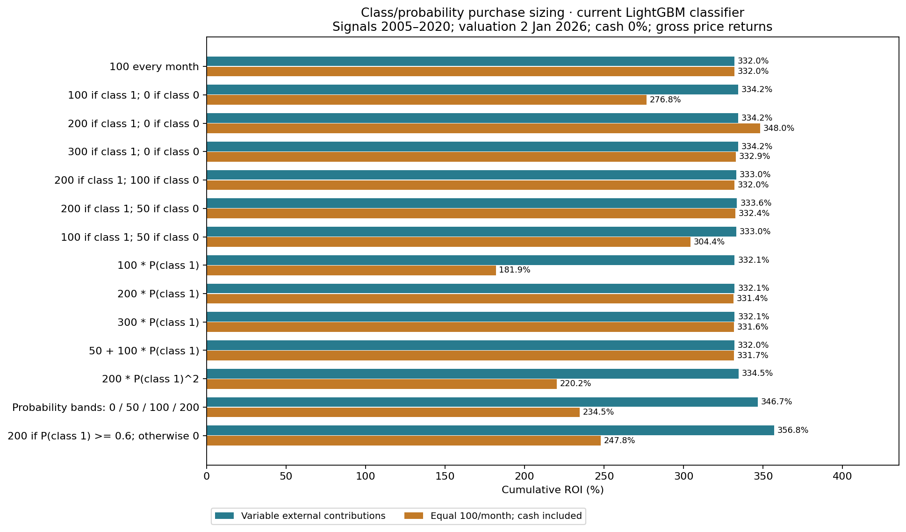

# Purchase amounts determined by class and probability

**The best new equal-budget rule in evaluation is to buy up to 200 when the current classifier predicts class 1 and zero when it predicts class 0: 348.02% ROI.** It beats DCA's 332.01%, but not the earlier fixed 36-month delay's 351.58%. None of the 106 new funding/signal/rule combinations establishes a stable improvement selected using development alone.

This extends the previous strategy experiment with the requested purchase-sizing rules. Fourteen rules including DCA are applied to both saved LightGBM classifiers (with/without oversampling), with natural and historical-validation class cutoffs, under two funding conventions. DCA appears once per convention, producing 106 rows. Probability-only rules do not use the binary cutoff; repeated natural/tuned outcomes remain explicitly labeled. No models are retrained and no evaluation probabilities are recalibrated.

## Two funding conventions

**Variable contributions:** contribute exactly the rule's requested amount that month and immediately invest it. ROI divides final profit by the actual contributions. Money not contributed is outside the account and outside its reported ROI; this is not a comparison of identical savings budgets. A 2x rule can require additional income/capital in favorable months.

**Equal monthly funding:** contribute 100 every month. A negative or low-confidence signal leaves money in a cash reserve earning 0%. Later purchases can exceed 100 only by spending accumulated cash. Each purchase is capped at cash already available; there is no initial reserve, borrowing or normalization using future signals. Final wealth includes unspent cash, and ROI uses all 19,200 contributed. A requested 200/100 rule collapses to DCA here because it never saves cash to fund larger purchases.

Both conventions execute at the first trading-session close strictly after the signal. Signals run from January 2005 to December 2020 and all holdings are valued on 2 January 2026. The purchase policies stop with the last signal; remaining cash stays cash. Existing holdings are never sold. Returns exclude dividends, fees and taxes. The 36-month target and five features are unchanged.

## Current classifier results

`P1` means the current oversampled classifier's raw probability of class 1. Class-based rows use its existing threshold selected on past validation. These probabilities are **not calibrated**, so proportional allocation is a tested heuristic rather than an estimate of an optimal stake.

| Requested purchase | Variable contributions, total | Variable-contribution ROI | Equal-100/month ROI |
| --- | ---: | ---: | ---: |
| DCA: 100 every month | 19,200.00 | 332.01% | 332.01% |
| Class 1: 100; class 0: 0 | 15,900.00 | 334.20% | 276.76% |
| **Class 1: 200; class 0: 0** | **31,800.00** | **334.20%** | **348.02%** |
| Class 1: 300; class 0: 0 | 47,700.00 | 334.20% | 332.88% |
| Class 1: 200; class 0: 100 | 35,100.00 | 333.00% | 332.01% |
| Class 1: 200; class 0: 50 | 33,450.00 | 333.57% | 332.45% |
| Class 1: 100; class 0: 50 | 17,550.00 | 333.00% | 304.39% |
| 100 × P1 | 10,517.94 | 332.06% | 181.91% |
| 200 × P1 | 21,035.88 | 332.06% | 331.43% |
| 300 × P1 | 31,553.83 | 332.06% | 331.64% |
| 50 + 100 × P1 | 20,117.94 | 332.04% | 331.72% |
| 200 × P1² | 12,835.67 | 334.55% | 220.19% |
| Probability bands: 0 / 50 / 100 / 200 | 13,400.00 | 346.74% | 234.53% |
| 200 when P1 ≥ 0.6; otherwise 0 | 15,000.00 | 356.84% | 247.83% |

Probability-band cutoffs are P1 < 0.4, 0.4 ≤ P1 < 0.6, 0.6 ≤ P1 < 0.8 and P1 ≥ 0.8. All thresholds and sizes were specified before this run; none was selected using evaluation ROI within a fitted fold.

## Interpreting 2x and probabilities

**A pure multiplier does not improve variable-contribution ROI.** Buying 100, 200 or 300 on precisely the same favorable months scales both contributed capital and terminal wealth. All three therefore have 334.20% ROI. At 1x the account ends at 69,038.13 on 15,900 contributed; at 2x it ends at 138,076.26 on 31,800 contributed. The same invariance holds for 100/200/300 × P1. No price, timing or prediction advantage is created by the multiplier itself.

**With fixed saving capacity, the multiplier changes purchase timing.** The 2x/0 rule accumulates cash on negative months and spends it over later favorable months. It ends at 86,019.72, versus 82,946.19 for DCA: +3,073.53 wealth and +16.01 ROI points. XIRR is 11.25% versus 10.98%; flow-adjusted maximum drawdown is -45.09% versus -56.78%. The prior 36-month-delay policy still leads on evaluation ROI at 351.58% and has -33.20% drawdown under the same budget/calendar. These risk figures include the holding period after signals stop.

**The 356.84% probability rule is not an equal-budget win.** Under variable contributions it invests only 15,000 and finishes at 68,525.64. Its XIRR is 10.78%, below DCA's 10.98%, despite its higher cumulative ROI, because contribution timing differs. With equal monthly funding, constrained purchases and all savings included, it ends at 66,783.59, including 5,500 cash: 247.83% ROI. These are two distinct financing policies, not two denominators applied to the same trades.

## Development selection and recommendation

Development signals cover 1982–1999; wealth is valued on 31 December 2004. Selection maximizes development ROI separately within each funding convention, including DCA. Evaluation remains the already explored 2005–2020 period.

- With variable contributions, **DCA wins development selection**. The 356.84% evaluation probability rule trails DCA by 43.74 ROI points in development.
- With equal funding, `300 × P1` from the oversampled classifier wins development by only +0.10 points, then loses to DCA by -0.37 points in evaluation (331.64%).
- The equal-funded 2x/0 class rule is the retrospective evaluation winner among these new rules, but loses to DCA by 13.96 points in development.

For further research, the 2x/0 class rule with a cash reserve is the strongest new equal-budget candidate from this evaluation. It is simpler to execute than tracking a separate 36-month purchase delay, but this run does not validate it as a replacement. The original classification reference and the prior recommendation to retain DCA as the operational baseline remain unchanged. The revised macro panel, inherited feature definitions, uncalibrated probabilities and repeated use of the evaluation period still limit the conclusion.

## Evidence and checks

Run `python -m scripts.compare_contribution_rules` from the repository root. [All 106 comparisons](all_combinations.csv) include contributions, wealth, profit, deployed amount, remaining cash, XIRR, drawdown and purchase-cap counts. The [current-classifier table](current_classifier.csv), [monthly purchase ledgers](purchase_ledgers.csv.gz) and [source fingerprints/selection identifiers](manifest.json) preserve the evidence.

The focused tests verify all 14 rules under both funding conventions, money conservation, multiplier invariance, next-session execution, use of past cash only, no retroactive purchase rescaling, and undefined ROI when there are no contributions.
