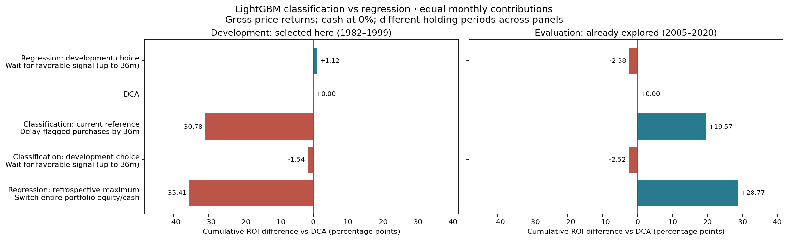

# LightGBM signals: classification, regression and investment policies

**Decision: keep the current classifier as a research reference; retain DCA as the operational baseline in this comparison. The experiment does not establish a dependable regression advantage.** Regression has the highest retrospective evaluation ROI, but the model/policy selected using development alone subsequently loses to DCA.

There are 677 comparisons: 26 model configurations, two alert rules and 13 signal policies, plus DCA. The horizon remains 36 months and the feature set remains the original five variables. The classifier with oversampling reproduces the previously saved predictions and ROI. All outputs use annual walk-forward predictions; the final full-history fitted model is not used for scoring.

## Main results

Evaluation contributions are 100 per month from January 2005 through December 2020: **19,200 per account**, valued on **2 January 2026**. Gross price returns exclude dividends, costs and taxes; cash earns 0%. ROI is cumulative; XIRR is annualized and incorporates contribution dates. Drawdown uses a daily account index adjusted for external contributions, including the post-signal holding period.

| Model and investment policy | Development advantage vs DCA | Evaluation ROI | Evaluation advantage vs DCA | XIRR | Maximum drawdown |
| --- | ---: | ---: | ---: | ---: | ---: |
| DCA | 0.00 pp | 332.01% | 0.00 pp | 10.98% | -56.78% |
| Current classifier + oversampling; delay flagged contributions 36 months | -30.78 pp | 351.58% | +19.57 pp | 11.30% | -33.20% |
| Classification policy selected on development; wait for favorable signal, maximum 36 months | -1.54 pp | 329.49% | -2.52 pp | 10.93% | -56.03% |
| Regression selected on development; wait for favorable signal, maximum 36 months | **+1.12 pp** | **329.63%** | **-2.38 pp** | 10.94% | -56.04% |
| Regression retrospective evaluation maximum; switch entire portfolio equity/cash | -35.41 pp | **360.78%** | +28.77 pp | 11.45% | -56.78% |

Development signals cover 1982–1999, with wealth valued on 31 December 2004; its DCA ROI is 298.63%. Development prices after that date never enter selection. Absolute development/evaluation ROIs have different investment durations and must not be compared directly. Each advantage above uses DCA on its own matching calendar.

**What regression actually adds.** The development winner is L2 regression with 3 leaves, learning rate 0.05 and negative-return oversampling. Its natural signal waits when predicted 36-month log return is non-positive. It ends with 82,488.93 versus DCA's 82,946.19: **457.26 less wealth**. Evaluation AP0 is 0.619, log-return RMSE 0.229 and R² 0.127. The current classifier ranks unfavorable months better here, with AP0 0.747.

The retrospective maximum instead uses L1 regression, 3 leaves, learning rate 0.025 and no oversampling, with the past-validation F1 threshold. It ends with 88,469.89, versus 86,704.17 for the current classifier strategy. That is an additional 9.20 cumulative ROI points, but only about **0.15 percentage points of XIRR**, with a substantially larger historical drawdown.

Crucially, this regression maximum issues **only two evaluation alerts**, in March and April 2012. Both months have positive realized 36-month returns, so its class-0 recall and F1 are zero. Both predictions are positive too: the alert is triggered because predicted log return (0.138172) lies just below the validation threshold (0.138776). The account exits at the close on 2 April 2012 and re-enters on 1 June 2012. Independent lot accounting reproduces its 88,469.89 terminal wealth. The ROI gain comes from that temporary market exit, not demonstrated detection of unfavorable 36-month outcomes. Selecting it because it wins in this already explored evaluation would be retrospective selection.

## Changing the policy while holding each signal fixed

These columns use the **current oversampled classifier with its validation cutoff** and the **development-selected oversampled L2 regressor with its natural zero cutoff**. No row switches to a different regressor to improve its displayed ROI. The full factorial table also contains other models and threshold rules.

| Investment policy | Classifier evaluation ROI | Regression evaluation ROI |
| --- | ---: | ---: |
| DCA baseline | 332.01% | 332.01% |
| Delay flagged contribution 3 months | 330.87% | 330.88% |
| Delay 6 months | 330.57% | 330.00% |
| Delay 12 months | 330.61% | 330.04% |
| Delay 24 months | 345.19% | 344.44% |
| Delay 36 months | 351.58% | 346.22% |
| Invest half immediately, delay half 12 months | 331.31% | 331.03% |
| Invest half immediately, delay half 36 months | 341.80% | 339.12% |
| Wait for a favorable signal, maximum 12 months | 329.49% | 329.63% |
| Wait for a favorable signal, maximum 36 months | 329.49% | 329.63% |
| Keep flagged contributions in cash through valuation | 276.76% | 274.15% |
| Fractional immediate investment, remainder delayed 12 months | 318.95% | 315.53% |
| Switch entire portfolio equity/cash on binary alert | 269.05% | 310.42% |
| Rebalance entire portfolio to fractional exposure | 193.86% | 174.96% |

The higher ROI of 24/36-month delays in evaluation does not imply those delays should be chosen now. They lost to DCA during development. Whole-portfolio trading is especially sensitive to the exact signal: the current classifier's binary policy ends at just 269.05%, while the retrospectively chosen regression reaches 360.78% with a different alert history.

## Checks that change the decision

**Economic advantage is concentrated.** For accounts starting contributions in 2009–2020, the current classifier's fixed 36-month delay produces 293.96% against DCA's 298.34% (**-4.38 pp**). Its positive full-period result is driven by 2005–2008. The development-selected regression also loses in the 2009–2020 cohort (-0.75 pp). These are restarted accounts, not additive portfolio decompositions.

**Modest fees do not explain away the ranking.** At 25 bp per traded notional, evaluation ROI is 330.93% for DCA, 350.46% for the current classifier, 328.56% for development-selected regression and 358.22% for retrospective-maximum regression. The issue is selection and stability, not a gross-versus-net arithmetic error. A hypothetical 2% cash yield with 10 bp costs leaves the development-selected regression below DCA by 2.20 pp. Dividends, taxes and genuinely historical cash yields remain absent.

**The default model and trading decision answer different questions.** The classifier was previously selected for development AP0 within the chosen horizon; this new experiment selects model/policy combinations for development ROI. A good risk ranking need not translate into a repeatable investment advantage. Keep the classifier for further research into risk identification. Use DCA as the baseline decision supported by this comparison; do not promote the highest retrospective regression ROI into the definitive model.

This is not a fresh holdout: the evaluation years and horizon have already been explored. The hybrid macro panel is not fully point-in-time and the inherited ERP unit mismatch remains. These constraints also prevent treating the present classifier as a confirmed live strategy. The next promotion decision needs corrected inputs and new untouched evidence, with the complete model, signal rule and investment policy frozen together.

## Reproduction and evidence

- [All 677 combinations and their predictive/economic metrics](all_combinations.csv)
- [Five-case shortlist](shortlist.csv), [model hyperparameters](model_grid.csv) and [annual fold audit](fold_audit.csv)
- [Monthly predictions](predictions.csv), [daily portfolio histories](portfolio_history.csv.gz), [cost/cash sensitivity](sensitivity.csv) and [cohort comparisons](cohorts.csv)
- [Exact policies, target definitions and assumptions](methodology.md); [source fingerprints and software versions](manifest.json)

Run `python -m scripts.compare_signal_strategies` from the repository root. The focused temporal/accounting suite passed 30 tests, including 21 new policy tests. The saved-output audit confirmed 677 unique combination identifiers, one development winner, 408 unique prediction months for each model, equal budgets in every comparison, all 51 source fingerprints and the independent regression-maximum calculation. All strategy results are research artifacts; the default fitted classifier is unchanged.
