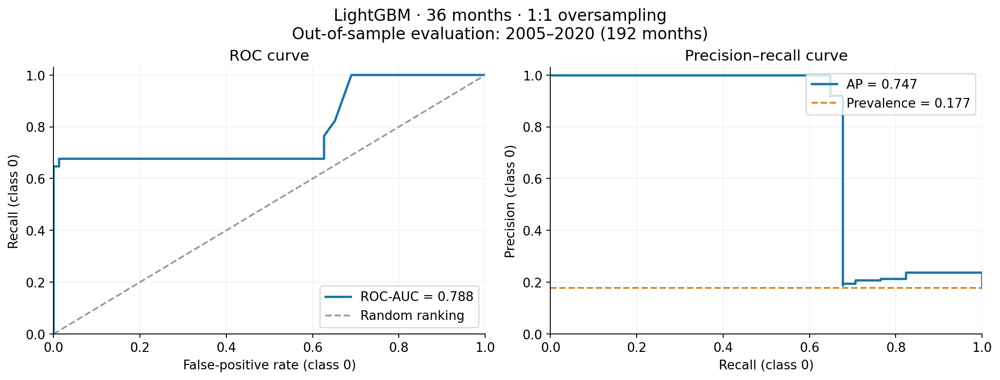
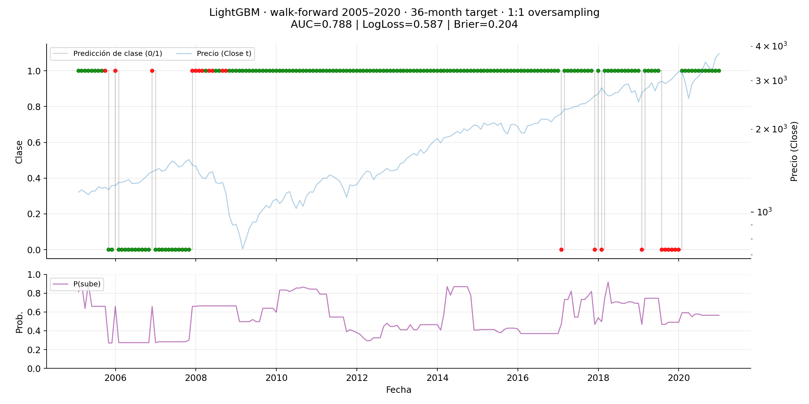
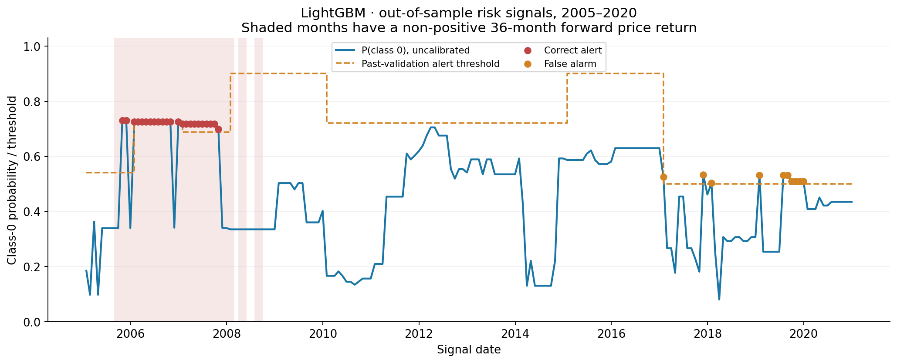
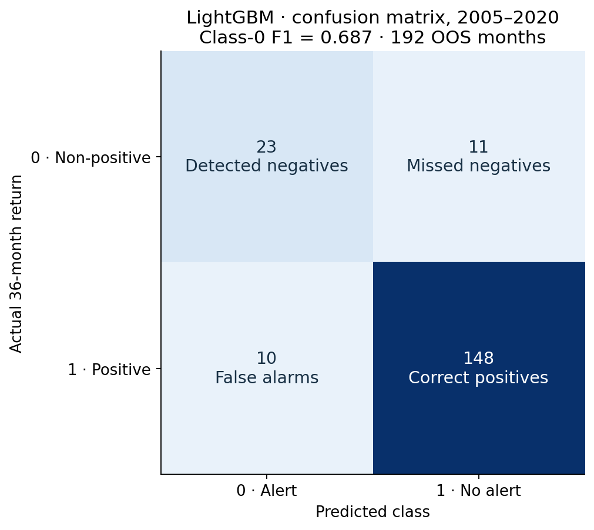
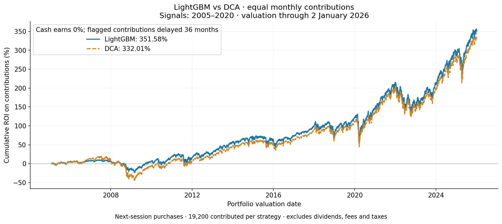
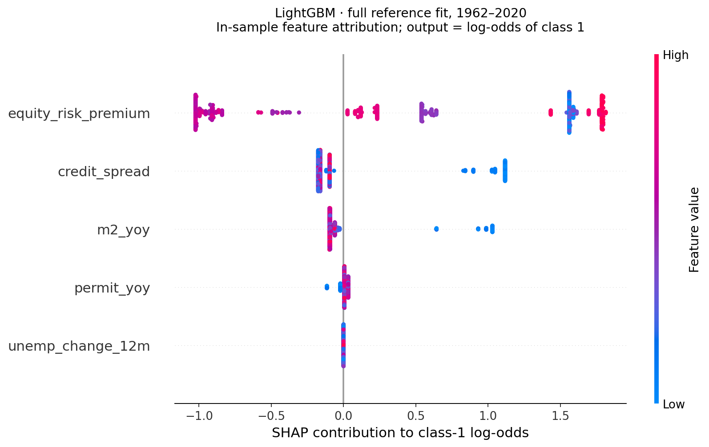
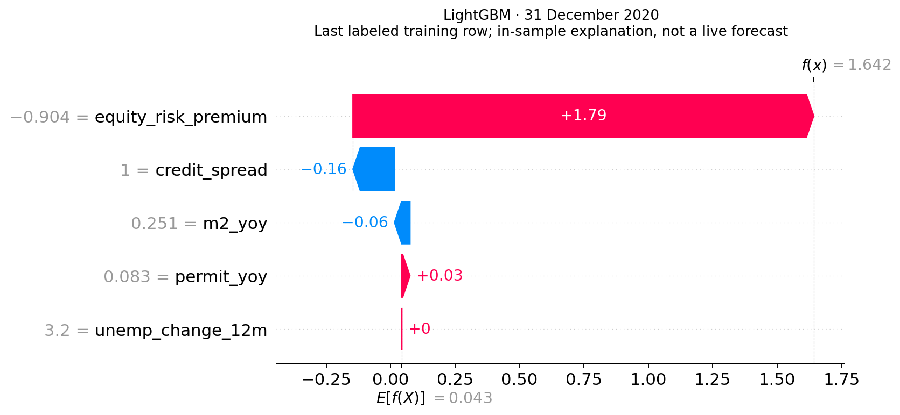

# LightGBM project figures

These seven figures document the selected **LightGBM, 36-month target, five original features and 1:1 oversampling**. They are regenerated from the saved reference artifacts rather than relabeled historical plots. The [source ledger](sources.json) records model, training-data, prediction and image hashes under `lightgbm_runs`; older source records remain intact.

## Out-of-sample evaluation

The 192 monthly predictions cover January 2005–December 2020 and come from annual purged walk-forward fits. Class 0 means a non-positive 36-month forward price return. Thresholds are selected on past validation data by class-1 F1. The overlapping monthly targets are not independent episodes.



ROC-AUC is 0.788 and class-0 AP is 0.747, versus negative-class prevalence 0.177. AP is computed using the class-0 probabilities, not class-1 probabilities.



The walk-forward timeline combines S&P 500 closing prices on a logarithmic scale, predicted classes and uncalibrated P(class 1). Green points indicate correct classifications and red points indicate errors. All 192 predictions come from the saved annual out-of-sample folds; predicted classes retain their historical validation thresholds.



Shading marks months whose realized 36-month price return is non-positive. Red dots are correct alerts and orange dots are false alarms. Probabilities from the oversampled model are uncalibrated.



The model detects 23 of 34 negative months, misses 11, and raises 10 false alarms. It correctly leaves 148 positive months unflagged. Class-0 F1 is 0.687. Matrix rows are actual classes and columns are predicted classes.

## Equal-budget strategy comparison



Each strategy receives 100 units per signal month in 2005–2020 (19,200 total). DCA buys on the next trading session. An alert defers that month's LightGBM purchase by 36 months; pending cash earns 0%. Both curves include shares and cash and are valued through 2 January 2026. Dividends, fees and taxes are excluded. The terminal cumulative ROI is 351.58% for LightGBM and 332.01% for DCA. The [daily portfolio history](selected_lightgbm/roi_history.csv) makes the calculation inspectable.

## Saved-model explanations



These exact Tree SHAP contributions explain the saved model fitted on all labeled rows from 1962–2020, including former test rows. They are **in-sample explanations**, not out-of-sample evaluation. Positive contributions increase class-1 log-odds. The inherited ERP definition dominates this fit; feature definitions still require the audit described in the [main README](../../README.md#selected-model-and-experiments).



The local explanation concerns 31 December 2020, the last labeled row in the reference fit. It is not a live market forecast. SHAP contributions plus their baseline are checked against the native model's raw output.

## Reproduction and archive

From the repository root:

```bash
python -m scripts.export_lightgbm_figures
```

The command loads the committed model and predictions, reconstructs and verifies the hybrid training panel for SHAP, checks the out-of-sample metrics and portfolio terminal values, then writes these PNGs and updates the source ledger. To rebuild the reference model itself, first run `python -m scripts.train_selected_model`.

[Historical XGBoost and thesis gallery](historical.md) preserves the earlier images and their provenance. The Airflow, Spark and MinIO screenshots in the main README describe the infrastructure PoC and are unchanged by the estimator selection.
